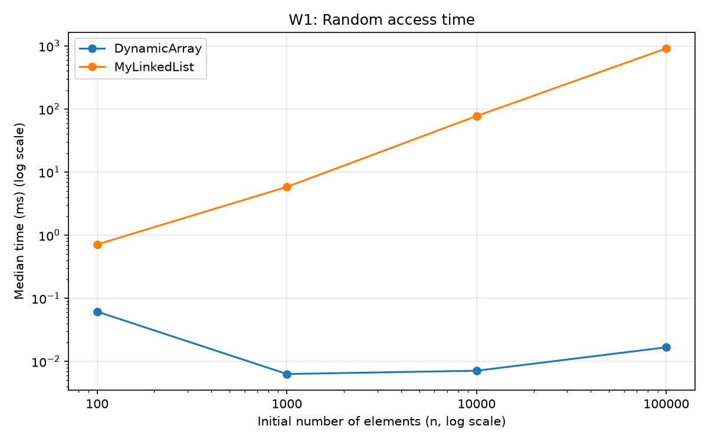
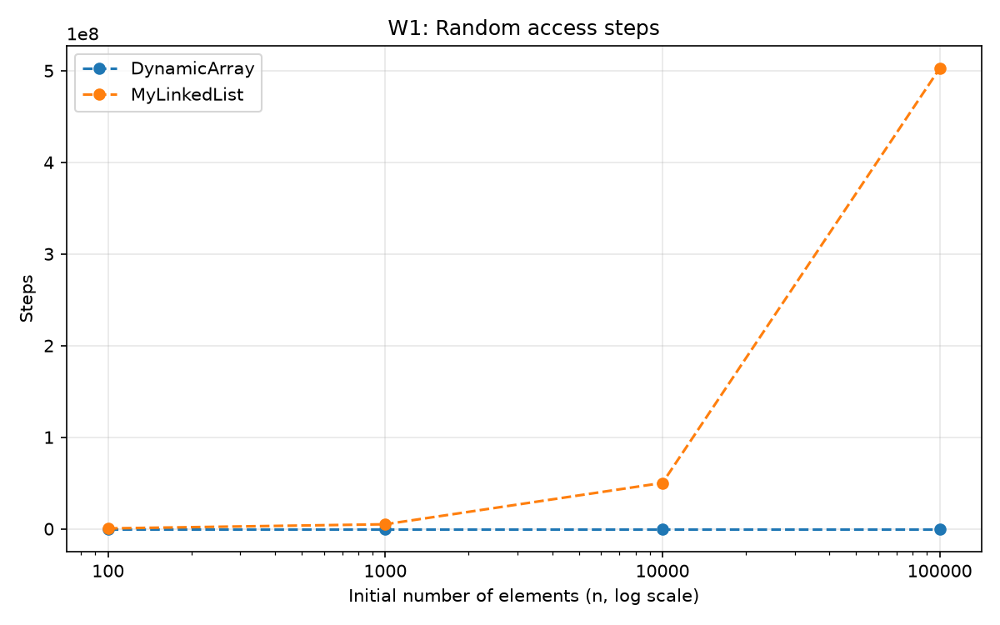
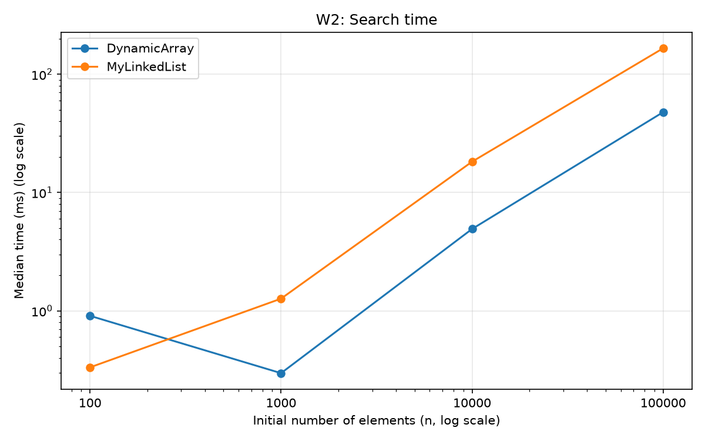
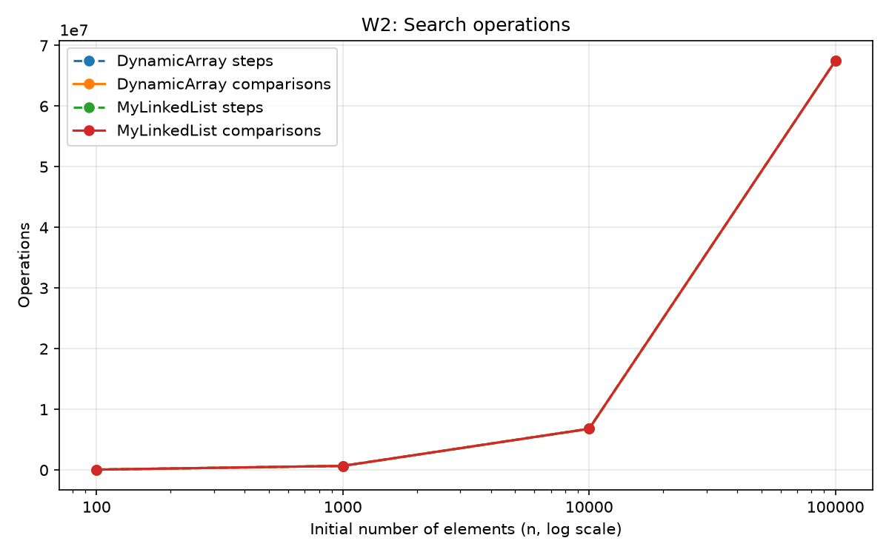
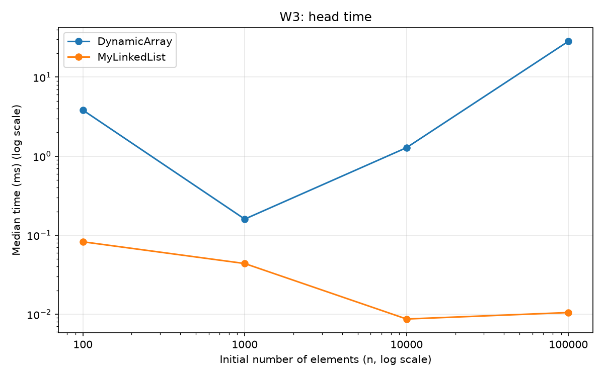
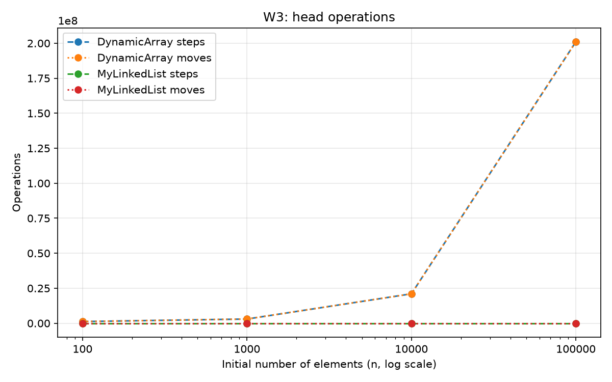
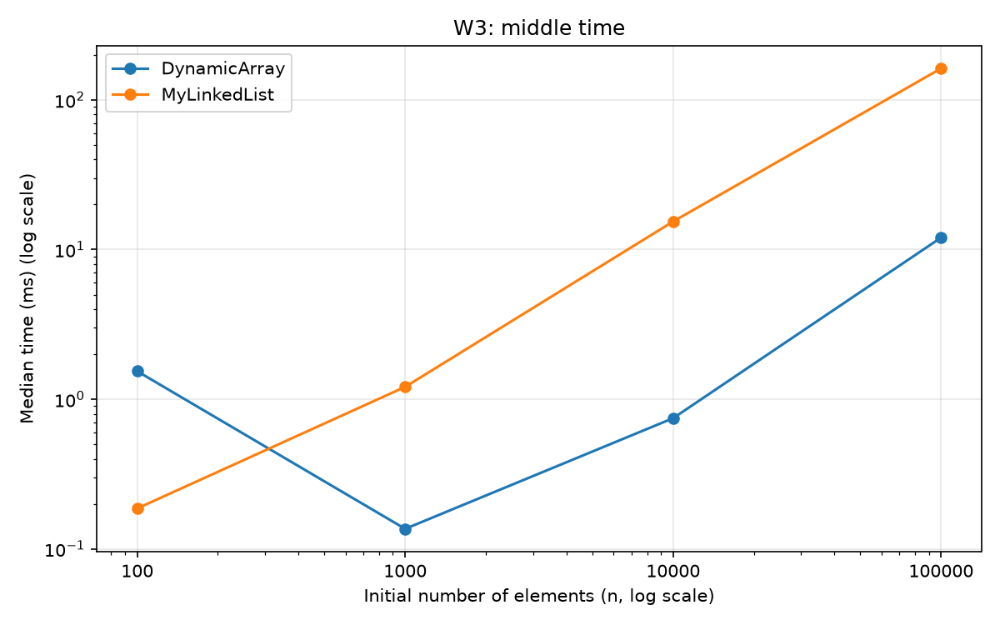
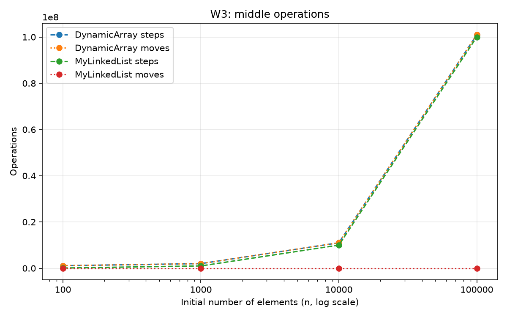
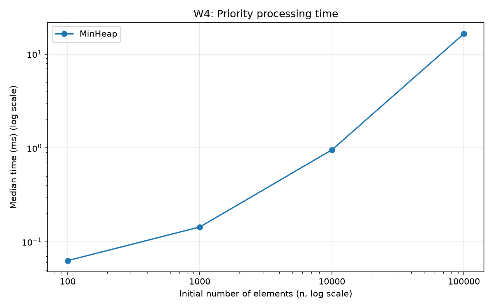
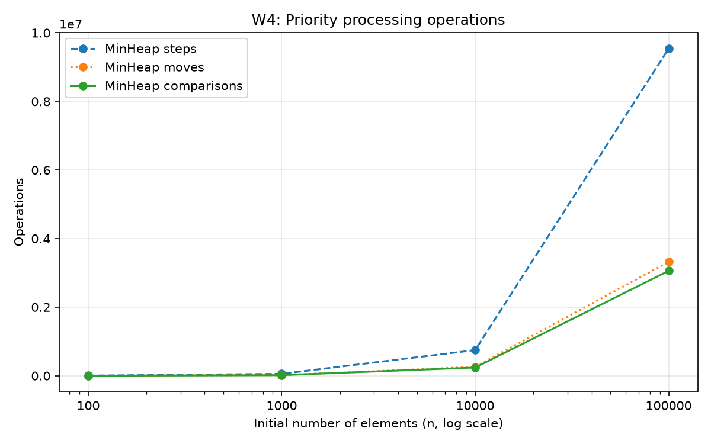

# Assignment 2 — Report

## Student and environment

- Student: [Student name]
- Group: [Group]
- Course: Design and Analysis of Algorithms
- Experiment date: 2026-10-04 (Asia/Qyzylorda)
- CPU: Intel Core 5 210H
- RAM reported by Windows: 16,780,750,848 bytes (about 15.63 GiB)
- OS: Windows 11 Pro, version 10.0.26300
- Java runtime: 26.0.2.1; compiler target: Java 25
- Maven: 3.9.9; JUnit: 5.11.4
- Python: 3.14.7; matplotlib: 3.11.2

The project does not contain a verified student name or group, so these two fields
are left for the student to fill in.

## Implementation

DynamicArray stores values in int[]. Its initial capacity is 10, and it doubles
capacity when full. Insertion and removal shift elements with ordinary loops.

MyLinkedList is a singly linked list. Each node has only int value and Node next.
The list keeps head and tail, so appending does not traverse the list.

MinHeap uses int[]. The parent of index i is (i - 1) / 2; its children are
2 * i + 1 and 2 * i + 2. insert uses bubble-up, and extractMin uses bubble-down.
The heap also doubles its array when full.

## A. Complexity table

n is the number of stored elements before an operation. The table describes valid
calls; rejecting an invalid index or an empty heap takes Theta(1).
Auxiliary space means extra memory used during a call, excluding existing storage.
Each structure's total storage is Theta(n).

For indexed operations, average assumes a uniformly chosen valid index.
For contains, average assumes a successful match at a uniformly chosen position,
or an absent value. Repeated duplicates can make a successful search shorter.
For heap averages, assume random-order distinct keys.

| Structure | Operation | Best | Average | Worst | Auxiliary space | Short justification |
|---|---|---|---|---|---|---|
| DynamicArray | add(x) | Θ(1) | Θ(1) amortized* | Θ(n) | Θ(n) on resize, otherwise Θ(1) | Append; a full array must be copied. |
| DynamicArray | add(index, x) | Θ(1) | Θ(n) | Θ(n) | Θ(n) on resize, otherwise Θ(1) | Shifts n-index values; best is append with spare capacity. |
| DynamicArray | remove(index) | Θ(1) | Θ(n) | Θ(n) | Θ(1) | Last index needs no shifts; head needs n-1. |
| DynamicArray | get(index) | Θ(1) | Θ(1) | Θ(1) | Θ(1) | Direct array access. |
| DynamicArray | contains(x) | Θ(1) | Θ(n) | Θ(n) | Θ(1) | Stops at a match or scans the whole array. |
| DynamicArray | size() | Θ(1) | Θ(1) | Θ(1) | Θ(1) | Returns one field. |
| DynamicArray | getMetrics() | Θ(1) | Θ(1) | Θ(1) | Θ(1) | Returns the existing Metrics object. |
| MyLinkedList | add(x) | Θ(1) | Θ(1) | Θ(1) | Θ(1) | Uses tail and creates one node. |
| MyLinkedList | add(index, x) | Θ(1) | Θ(n) | Θ(n) | Θ(1) | Head and append are constant; other indexes need traversal. |
| MyLinkedList | remove(index) | Θ(1) | Θ(n) | Θ(n) | Θ(1) | Head is constant; other indexes need the previous node. |
| MyLinkedList | get(index) | Θ(1) | Θ(n) | Θ(n) | Θ(1) | Traverses index next links. |
| MyLinkedList | contains(x) | Θ(1) | Θ(n) | Θ(n) | Θ(1) | Walks nodes until a match or null. |
| MyLinkedList | size() | Θ(1) | Θ(1) | Θ(1) | Θ(1) | Returns one field. |
| MyLinkedList | getMetrics() | Θ(1) | Θ(1) | Θ(1) | Θ(1) | Returns the existing Metrics object. |
| MinHeap | insert(x) | Θ(1) | Θ(1) expected amortized* | Θ(n) | Θ(n) on resize, otherwise Θ(1) | Bubble-up is at most logarithmic; resize copies n cells. |
| MinHeap | peekMin() | Θ(1) | Θ(1) | Θ(1) | Θ(1) | Reads the root. |
| MinHeap | extractMin() | Θ(1) | Θ(log n) | Θ(log n) | Θ(1) | May stop immediately; normally moves down the heap. |
| MinHeap | size() | Θ(1) | Θ(1) | Θ(1) | Θ(1) | Returns one field. |
| MinHeap | getMetrics() | Θ(1) | Θ(1) | Θ(1) | Θ(1) | Returns the existing Metrics object. |
| MinHeap | hasHeapProperty() | Θ(1)** | Θ(n) on valid heaps | Θ(n) | Θ(1) | Diagnostic scans parent-child pairs. |

*Amortized cost and average-case cost are different ideas. For add(x), the table
shows amortized cost over many appends, since no probability distribution over
capacities was chosen. A single call on a full array takes Θ(n), even for random values.
For heap insert, random-order keys give expected constant bubble-up work;
array doubling adds constant amortized copying per insertion.
[Stanford's heap lecture](https://web.stanford.edu/class/archive/cs/cs106b/cs106b.1206/lectures/heaps/)
also describes constant average insertion for random inputs.
Without a resize, worst-case heap insertion is Θ(log n); with a resize, it is Θ(n).
Across arbitrary insertion sequences the amortized upper bound is O(log n).

**The diagnostic can return immediately on an invalid first parent-child pair.
On a valid heap it always takes Θ(n). It does not change benchmark metrics.
extractMin can take constant time for equal keys; with random distinct keys its
average and worst-case bubble-down costs are logarithmic.

For a particular index i, array insertion shifts n-i elements, while list insertion
traverses i-1 links except for its head and tail shortcuts.
List removal at the last index still needs traversal because the list is singly linked.
There is no shrinking and no recursive algorithm, so removal has constant extra space.

## B. Loop invariant: DynamicArray.contains

**Invariant:** Before iteration i, all elements at indexes 0 through i-1 have
been checked, and none equals the searched value.

**Initialization:** At i=0 the checked prefix is empty, so the statement is true.

**Maintenance:** If elements[i] equals the searched value, returning true is correct.
Otherwise this element also does not match. After i increases, the enlarged prefix
still contains no match.

**Termination:** Each continuing iteration increases i. Eventually i reaches size,
unless a match has already caused a return. At size, every stored element was checked.

**Conclusion:** The method returns true when it finds a stored match, and false
only after all stored elements fail to match. The empty array correctly returns false.

## C. Loop invariant: MinHeap.bubbleDown

**Invariant:** Before each iteration, both child subtrees of the current index
are min-heaps. Every parent-child edge is ordered except possibly the edges
from the current element to its children.

**Initialization:** extractMin moves the last element to the root and removes
its old leaf position. Only the new root can violate heap order; the child
subtrees keep their existing order.

**Maintenance:** The loop selects the smaller child. If the current value is
no greater than that child, both child edges are ordered, so it stops.
Otherwise it swaps with the smaller child. The old parent position is now ordered
with both children. The displaced value can violate order only at its new child
position, where the next iteration continues.

**Termination:** Each swap moves one level down a finite tree. The loop ends at
a leaf or when the current element is no greater than the smaller child.

**Conclusion:** At termination there is no remaining unordered edge. The whole
array represents a min-heap again, so the root is the smallest stored value.

## Method and validation

The sizes are 100, 1000, 10000 and 100000. For each size, W1-W3 use one int[]
generated by new Random(42), with values in 0..n-1. Both structures get exactly
the same values on every run. Duplicate values are allowed.
W4 keeps its original Random(42) generation of full-range int values.

- W1 performs 10000 reproducible random get calls. Their sum is checked against the dataset.
- W2 makes 1000 contains queries. 500 are sampled from the dataset; 500 are in n..2n-1 and are absent. Exactly 500 matches are checked.
- W3 makes 1000 insertions followed by 1000 removals. head uses index 0; middle uses the fixed index n/2. Removed-value sums and final sizes are checked.
- W4 inserts n values, extracts n values and checks that output is non-decreasing.

Every case runs twice for warm-up and five times for measurement.
Warm-up times are discarded. System.nanoTime() measures elapsed time, and the
middle of the sorted five values is saved in milliseconds.
Input generation, initial filling for W1-W3 and correctness checks are outside timing.
W4 includes both insertion and extraction, as required.

The CSV has 36 rows, covering every required combination.
steps counts internal array-cell reads or following a list next link;
moves counts array relocation or changes to structural list pointers;
comparisons counts value comparisons. Loop bounds and index checks are excluded.
W1-W3 counters are reset after setup. W4 counters include all inserts and extractions.
Counters are taken from the last measured run because inputs and operation counts
are identical in all five runs. Timing includes the small cost of counting operations.

All 12 JUnit 5 tests passed, with zero failures, errors or skipped tests.
Existing tests cover all requested edge cases and random comparisons with standard
Java collections. Heap order is checked after insertion and extraction, and
extracted output is checked for non-decreasing order.
Reports are in target/surefire-reports.

## D. Plots and measured results

The charts were generated from results/results.csv by results/generate_plots.py.
The n axis is logarithmic in every chart. Time charts also use logarithmic time
so fast and slow structures remain visible. Operation counts use a linear axis.
Some operations overlap: W2 steps and comparisons differ by only 500 for the list,
and array steps and moves in W3 are nearly identical.

### W1: Random access

### W2: Search

### W3: Insert and remove

### W4: Priority processing

At n=100000, the saved median times were:

| Workload | Variant | DynamicArray (ms) | MyLinkedList (ms) | MinHeap (ms) |
|---|---|---|---|---|
| W1 | - | 0.0167 | 911.3555 | - |
| W2 | - | 47.8197 | 165.8299 | - |
| W3 | head | 28.4140 | 0.0105 | - |
| W3 | middle | 12.0158 | 162.1661 | - |
| W4 | - | - | - | 16.4631 |

W1 used 10000 array reads but 502489208 list traversal steps.
W2 made the same 67478791 value comparisons in both structures.
W3 head used 200999000 array moves, compared with 3000 list pointer updates.
W3 middle required 100000000 list traversal steps, although its pointer updates
were still only 3000. This shows why counting pointer updates alone is insufficient.
W4 made 3059283 value comparisons. These are observations from this run;
very short timings and background activity can cause variation.

## E. Discussion

DynamicArray is faster for get(i) because it reads the requested cell directly.
MyLinkedList must walk from head to reach the same index.
A CPU fetches memory in cache lines, which can contain several neighbouring int values.
Array cells are next to each other, so scanning them has good spatial locality.
The linked list uses pointer chasing: each next address is obtained from the current node.
Nodes may be spread around memory, which can make cache use less efficient.
Each node is a separate Java object with an object header and a next reference as well as its value.
Creating many nodes adds allocation work, and removed nodes may later need garbage collection.
GC and JVM compilation can change measured times, but this experiment does not measure their individual costs.
Two operations can have the same Big-O and still run differently because their memory accesses and constant costs differ.
MyLinkedList is useful for repeated insertion and removal at the head.
Its tail makes appending fast, but access or changes in the middle still require traversal.
MinHeap is useful when we repeatedly need the smallest value, such as the next task with the lowest priority number.
The measurements show that the best structure depends on the operation, not just the number of stored values.

## F. Conclusion

The dynamic array worked well for random access and scanning.
The linked list was especially effective for changes at the head, but middle
operations had a high traversal cost. The heap produced sorted extraction output
while maintaining its order with bubble-up and bubble-down.
Operation counts explain these differences more reliably than one short time value.
All required tests and benchmark cases completed successfully.
No bonus tasks were implemented.

## Git workflow

The original commit 99f0116 is preserved. feature/array, feature/list, feature/heap
and feature/metrics point to that existing working baseline, which already contains
all four components. No earlier feature-by-feature history was invented.
main contains the final fixes, report, CSV and plots, and v1.0 marks that final commit.
No push or history reset was performed.
